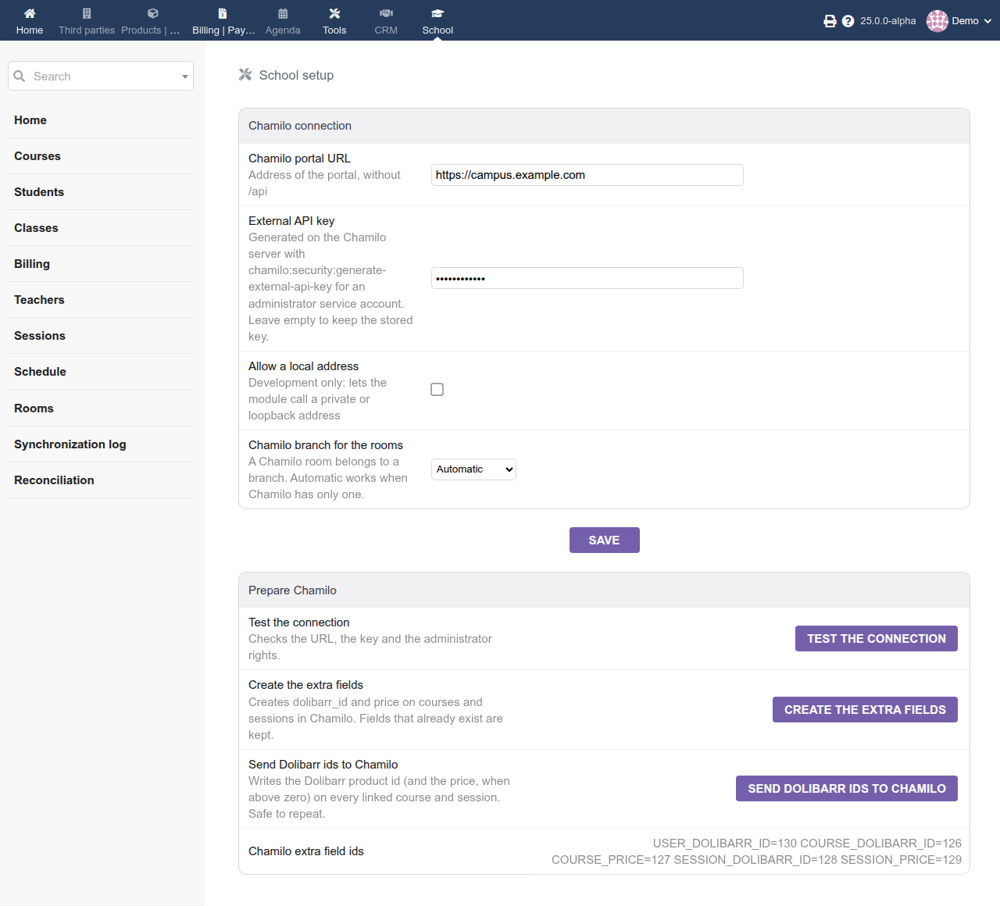
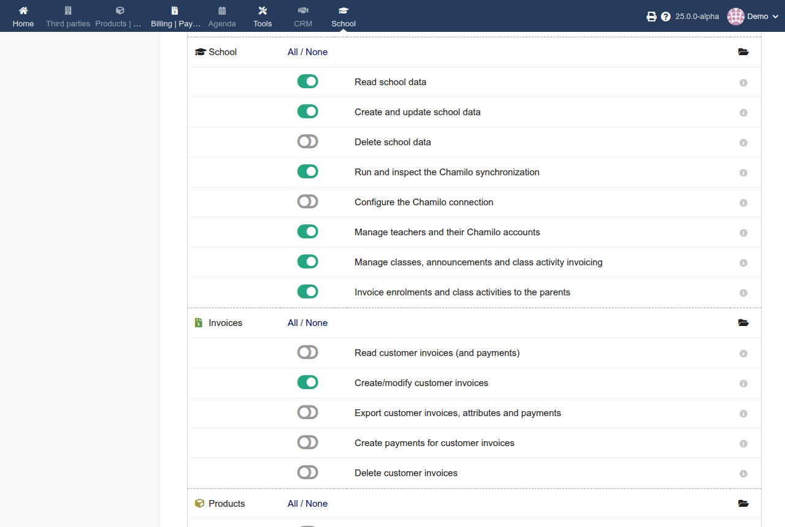
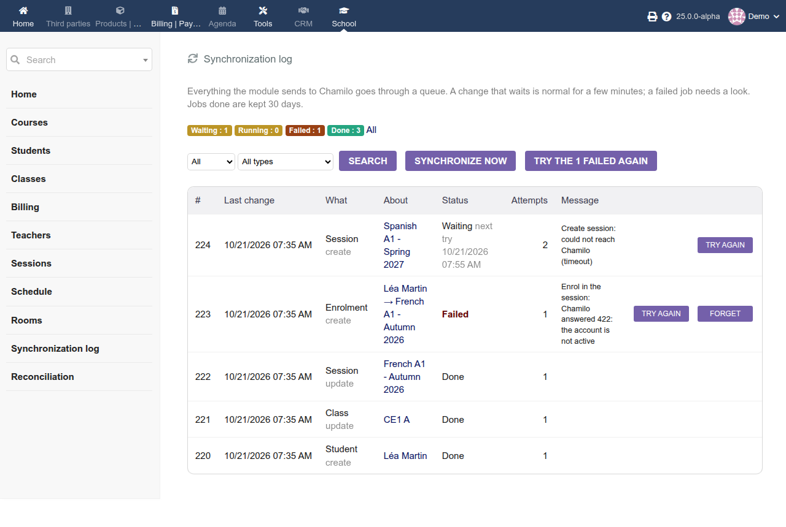
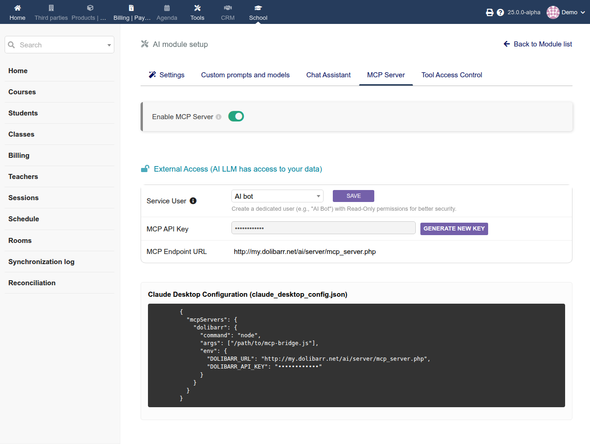
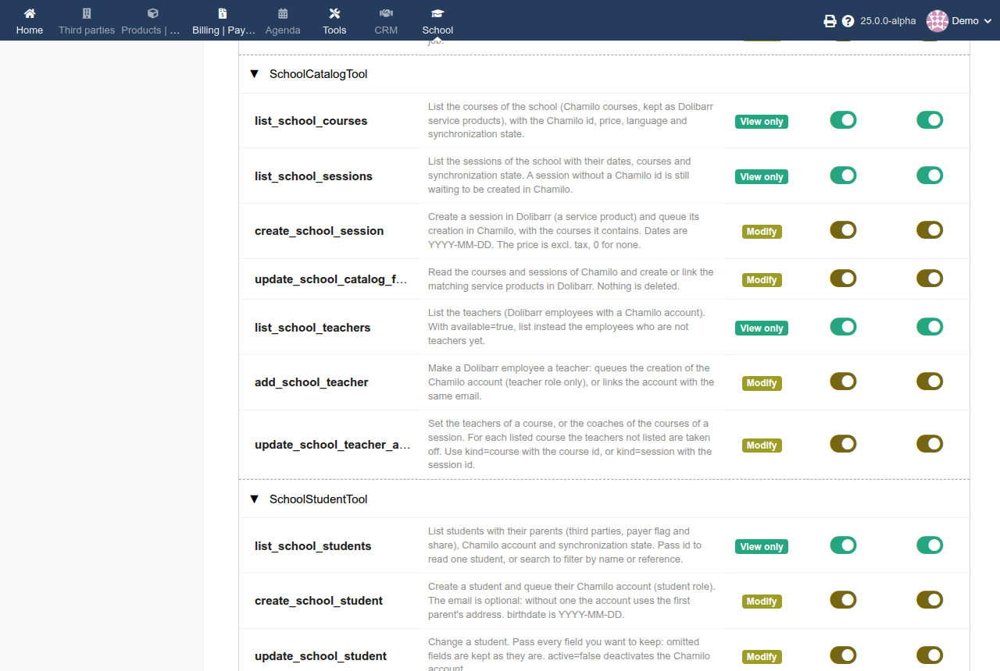

# Administrator guide

For the person who installs and configures the School module. Installation steps are in [INSTALL.md](../INSTALL.md); this guide explains what is configured, which rights each person needs, what the module does behind the scenes, how to connect an AI assistant (MCP), and what to check when something goes wrong. What staff see and do is in [USER_GUIDE.md](USER_GUIDE.md); the list of MCP tools is in [MCP.md](MCP.md).

Contents: [Settings](#settings) · [Rights](#rights) · [The Chamilo service account](#the-chamilo-service-account) · [The synchronization queue](#the-synchronization-queue) · [What is created in Chamilo](#what-is-created-in-chamilo) · [Data model](#data-model) · [Billing](#billing) · [MCP tools](#mcp-tools) · [Reconciliation](#reconciliation) · [Rooms and schedule](#rooms-and-schedule) · [Announcements to parents](#announcements-to-parents) · [Security notes](#security-notes) · [Troubleshooting](#troubleshooting)

## Settings

Everything is on **Home > Setup > Modules/Applications > School (wrench icon)**.

*The School setup page (**Home > Setup > Modules/Applications > School**). The key field is never filled in again after saving.*

| Setting | Constant | Notes |
|---|---|---|
| Chamilo portal URL | `SCHOOL_CHAMILO_URL` | Address of the portal without `/api`. Must start with `http://` or `https://`. A trailing slash or `/api` is removed. |
| External API key | `SCHOOL_CHAMILO_API_KEY` | Stored encrypted with Dolibarr's own encryption. The field stays empty after saving: leaving it empty keeps the stored key. |
| Allow a local address | `SCHOOL_CHAMILO_ALLOW_LOCAL` | Off by default. When off, the module refuses to call a private or loopback address, as protection against requests to internal services. Turn it on on a development machine only. |
| Chamilo extra field ids | `SCHOOL_EF_USER_DOLIBARR_ID`, `SCHOOL_EF_COURSE_DOLIBARR_ID`, `SCHOOL_EF_COURSE_PRICE`, `SCHOOL_EF_SESSION_DOLIBARR_ID`, `SCHOOL_EF_SESSION_PRICE` | Filled by **Create the extra fields**. Shown at the bottom of the page. |
| Send the new-account message | `SCHOOL_TEACHER_SEND_EMAIL` | On unless set to `0`. When on, Chamilo emails a newly created teacher a link to choose a password. Set it with **Home > Setup > Other setup**, or in the `llx_const` table. |
| Student email | `SCHOOL_STUDENT_EMAIL_DOMAIN` | Domain of the placeholder address (`username@domain`) given to a student who has no email and no parent with one. Leave it empty to refuse such students instead. It does not need to receive mail unless you want it to. |
| Send the new-account message to students and parents | `SCHOOL_STUDENT_SEND_EMAIL`, `SCHOOL_PARENT_SEND_EMAIL` | On unless set to `0`. A student's message goes to the address of the account, which is normally a parent's mailbox. |
| Chamilo branch for the rooms | `SCHOOL_CHAMILO_BRANCH_ID` | Chosen on the setup page from the branches of Chamilo. A Chamilo room belongs to a branch. *Automatic* (0) picks the only branch and fails with a clear message when Chamilo has several. |
| Title of the attendance sheets | `SCHOOL_ATTENDANCE_TITLE` | Title (default `Attendance`) of the attendance the module creates in Chamilo for each course of a session, or for a course on its own. Not on the setup page: set it in **Home > Setup > Other setup**. Changing it does not rename sheets that exist. |
| Days the synchronization log keeps done jobs | `SCHOOL_LOG_KEEP_DAYS` | 30 by default; 0 keeps every job. The scheduled job deletes the done jobs older than this. Failed and waiting jobs are never purged. Set it in **Other setup**. |
| Chamilo portal id | `SCHOOL_CHAMILO_ACCESS_URL_ID` | Optional. Without it the module finds the portal whose address has the same host and port as the configured URL. Set it if that detection cannot work, for example behind a proxy that changes the host. |

The buttons of **Prepare Chamilo** (test the connection, create the extra fields, send the Dolibarr ids) can be pressed again at any time; none of them duplicates anything.

Settings that are not on the setup page are plain Dolibarr constants: **Home > Setup > Other setup** lists and edits them (administrators only), and a constant that is absent has the default given above.

## Rights

Assign them in **Home > Setup > Users and groups** (a user or a group, tab *Permissions*). Dolibarr administrators hold every right. The menu entries show only what the user can read.

### The module's rights

| Right | Allows |
|---|---|
| Read school data (`read`) | See the School menu, the home page, the lists (courses, sessions, students, classes, teachers, rooms, schedule, synchronization log) and the cards, the **Children** tab of a third party, and read with the MCP tools. Nothing can be changed with this right alone. |
| Create and update school data (`write`) | Create sessions; create and edit students, their parents, their enrolments; adopt and edit rooms; add, change and cancel dates of the schedule |
| Delete school data (`delete`) | Reserved: no screen or tool needs it today (removals are covered by the right of the thing removed) |
| Run and inspect the Chamilo synchronization (`sync`) | **Import from Chamilo**, **Synchronize now** (also from the rooms, schedule, students, classes, teachers and log pages), **Import the rooms of Chamilo**, the **Synchronization log** actions (try again, forget), and the **Reconciliation** report and its fixes |
| Configure the Chamilo connection (`setup`) | The setup page and its buttons (connection, extra fields, branch, Dolibarr ids) |
| Manage teachers and their Chamilo accounts (`teacher`) | Enable a Dolibarr employee as a teacher (this creates or links a Chamilo account), **Send again**, and choose the teachers of courses and the coaches of sessions. Kept apart from `write` so that not everyone who can edit school data can create Chamilo accounts for staff. |
| Manage classes, announcements and class activities (`class`) | Create and edit classes, their members and sessions, prepare the announcement to the parents, create and delete the activities of a class, **Send again** a class |
| Invoice enrolments and class activities to the parents (`invoice`) | Use **School > Billing** and the **Invoice** link of an activity |

### Rights of other modules that the module also needs

| Right | Needed for |
|---|---|
| Invoices: *Create and update invoices* (`facture/creer`) | **School > Billing**, and the MCP tool that creates invoices. Together with the School `invoice` right and the Invoices module. |
| Emailing: *Create and update emailings* (`mailing/creer`) | Preparing the announcement to the parents. The Emailing module must be enabled: until it is, its rights do not exist in Dolibarr and nobody can be given them. Sending the campaign needs the Emailing rights too. |
| Resources and Agenda | None for the module's screens: the room and the dates are created by the module itself. Users who open Dolibarr's own resource pages (the planning link of a room) need the Resources rights as usual. |
| AI (module) | Not a right of the module, but the MCP server and the AI assistant need the AI module enabled (see "MCP tools"). |

### Which right for which screen

| Screen | See it | Change something |
|---|---|---|
| Home, lists, cards, schedule, rooms | `read` | see below |
| Courses: **Import from Chamilo** | `read` | `sync` |
| Sessions: **New session** | `read` | `write` |
| Courses and sessions: choose teachers or coaches | | `teacher` |
| Teachers: **Enable on Chamilo**, **Send again** | `read` | `teacher` (and `sync` for **Synchronize now**) |
| Students and their cards: create, edit, parents, enrol | `read` | `write` |
| Classes: **New class**, card, members, sessions, announcement, activities | `read` | `class` |
| Billing | `invoice` + `facture/creer` | the same |
| Rooms: adopt, edit capacity and floor | `read` | `write`; **Import the rooms of Chamilo** needs `sync` |
| Schedule: add, change, cancel dates | `read` | `write` |
| Synchronization log, **Synchronize now** | `read` | `sync` |
| Reconciliation | `sync` | `sync` |
| Setup page | `setup` | `setup` |

### Suggested sets

| Person | Rights |
|---|---|
| Secretary | `read`, `write` |
| Person who manages staff and classes | + `teacher`, `class` |
| Accountant | `read`, `invoice`, and Invoices *create* |
| Person who looks after the synchronization | `read`, `sync` |
| Administrator of the connection | `setup` (and `sync` to test it) |
| An AI assistant (MCP user) | See "MCP tools": only the rights of what you want it to do |

*Rights of an assistant's user in **Users and groups > Permissions**: the School rights it needs for reading, writing, classes, invoicing and synchronization, the Invoices *create* right, and neither *Delete* nor *Configure*.*

## The Chamilo service account

The key belongs to a Chamilo account, and the module acts with that account's permissions. It must be an **administrator**: creating sessions and extra fields, changing courses and managing class subscriptions are administrator operations in Chamilo's API. Use a dedicated account (for example `dolibarr-sync`), not a person's account, so that revoking the key or deactivating the account stops the synchronization without affecting anyone.

To revoke access: `php bin/console chamilo:security:generate-external-api-key <username> --access-url-id=1 --revoke`, or turn off `security.external_api_enabled` in Chamilo, which stops every external key at once.

## The synchronization queue

Each change that has to reach Chamilo is a job in `llx_school_syncqueue`:

| Status | Meaning |
|---|---|
| Waiting (0) | Will be sent at the next run |
| Running (3) | Being sent. A job left running for more than 15 minutes (a run that crashed) goes back to Waiting. |
| Done (1) | Sent |
| Failed (2) | Will not be retried: the error is in `last_error` |

The School home page shows the number of jobs per status.

- **When it runs.** The scheduled job `SchoolSyncQueue` runs every 5 minutes if Dolibarr's scheduler is triggered (see INSTALL.md). **Synchronize now** (on the sessions, students, classes, teachers, rooms, schedule and log pages) runs it immediately. Each run first deletes the done jobs older than `SCHOOL_LOG_KEEP_DAYS`, then sends up to 50 jobs, then reads back the attendance of up to 20 dates (see "Rooms and schedule").
- **Retries.** A job that fails because Chamilo cannot be reached, times out, rate-limits (429) or answers with a server error is retried after 1 minute, then 2, 4, 8, and so on, never more than 1 hour apart, up to 8 attempts. After that it becomes Failed.
- **No retry.** Any other error, such as a validation error (422), a refused permission (403) or a missing object (404), would fail again, so the job becomes Failed at once with Chamilo's message.
- **No duplicates.** Two identical waiting jobs are merged. A session's Chamilo id is saved as soon as Chamilo has created it, so a retry after a partial failure carries on instead of creating a second session.
- **A session shows its own state** in the Sessions list: Waiting, Synchronized, or Error (hover to read the message).

**School > Synchronization log** lists the jobs, newest first, with what each is about (a link to the student, class, session...), its status, attempts, next try and message; it can be filtered by status and type. With the `sync` right, a Failed job (or a waiting one that already failed once) can be **tried again** at once, all the failed ones can be retried together, **Synchronize now** runs the queue, and a failed job can be **forgotten** (its object keeps its own error and is sent again when it changes). A running or done job cannot be retried. Jobs done are deleted after `SCHOOL_LOG_KEEP_DAYS` days (30 by default; 0 keeps them all) by the scheduled job.

*The synchronization log (see also the user guide).*

## What is created in Chamilo

- Two extra fields on **courses** and two on **sessions**: `dolibarr_id` (text, the Dolibarr **product id**) and `price` (decimal). They hold the link between the two systems and let Dolibarr find an object again without relying on its title.
- `price` is the field the Chamilo WordPress storefront plugin reads. It is written only when the Dolibarr price is above zero: for the storefront, an item with no price is not for sale.
- Sessions created from Dolibarr, with their dates and courses.
- **Student accounts**, with the student role (status 5), and **parent accounts** for the parents who follow their children, with the human resources manager role (status 4): this is how Chamilo models "a user who follows other users". The "follows" link is Chamilo's own HR relation between the parent and the child. A parent account is created from a contact of the third party, so the contact needs an email; it is shared by all the children of that parent. If you rename the HR manager role to "parent" in Chamilo, nothing changes for this module.
- **Teacher accounts**, created with the teacher role (status 1).
- On every account the `dolibarr_id` extra field holds a typed reference to Dolibarr: `user:<id>` for a teacher, `student:<id>` for a student, `contact:<id>` for a parent. They are three different tables, so a bare number would be ambiguous. The module never changes the role of an account: an account that already exists is linked as it is, and the teacher list shows a warning icon when that account is not a teacher. Nobody can become an administrator through the synchronization.
- Teachers and coaches of courses and sessions, using Chamilo's own course user actions.
- **Rooms** (`/api/rooms`), with the title of the Dolibarr resource, its capacity and floor, in the branch chosen on the setup page.
- **Attendance sheets**: one per course of a session (or per course on its own), created with the title `SCHOOL_ATTENDANCE_TITLE` and a marker in its description so that the module finds it again. Each date of the schedule is a date of that sheet, with its start, duration and room. The module only creates, moves and removes the dates; the presences are recorded by the teachers in Chamilo and read back by the module.
- **Classes**, as Chamilo classes (user groups of the "normal class" type), through `/api/usergroups`. Each push replaces the whole list of members and of sessions, which is how Chamilo's class routes work. Chamilo enrols the members of a class in the sessions linked to it and takes a student out of them when they leave, so a student who is also enrolled on their own in one of those sessions is taken out of it too when leaving the class. A class is never deleted in Chamilo by this module: archiving a class in Dolibarr leaves it as it is.
- Enrolments: a student is added to or removed from a course with Chamilo's course user actions, and from a session with `/api/sessions/{id}/students`, which subscribes the student to every course of the session and keeps the other students. Chamilo is read first each time, and nothing is removed that Dolibarr did not name.
- Accounts that already exist are linked, not changed: by email for a teacher, a parent, and a student who has an own email. An account found by email is never given a role, and a warning icon shows when it does not have the expected one. An email that belongs to a deleted account is refused.

The Chamilo API cannot delete extra fields or their values. If you delete a session or a course in Chamilo, its `dolibarr_id` and `price` values stay in the database, unused.

## Data model

Created by the module and kept when it is disabled:

| Table | Content |
|---|---|
| `llx_school_course`, `llx_school_session`, `llx_school_session_course` | The Dolibarr side of Chamilo courses and sessions (Dolibarr product, Chamilo id, language, dates, sync state) |
| `llx_school_teacher`, `llx_school_course_teacher`, `llx_school_session_teacher` | Teachers (Dolibarr users) and what they teach or coach |
| `llx_school_student`, `llx_school_student_parent` | Students, and their parents (Dolibarr third parties) with the share of the cost each parent pays |
| `llx_school_enrolment` | Individual enrolments of a student in a course or session |
| `llx_school_class`, `llx_school_class_student`, `llx_school_class_session` | Classes, their members and the sessions they follow |
| `llx_school_class_activity`, `llx_school_class_activity_invoice` | Extra activities of a class and what was invoiced to which parent |
| `llx_school_guardian` | The Chamilo account of a parent who follows children (one per contact) |
| `llx_school_enrolment_invoice` | What was invoiced for each enrolment, to which third party and in which share |
| `llx_school_room` | The resources used as rooms: floor and Chamilo room id (the capacity is the resource's `max_users`) |
| `llx_school_occurrence`, `llx_school_attendance` | The dates of the schedule (linked to an agenda event and a room) and the Chamilo attendance sheet of each course and session |
| `llx_school_presence` | The presences read back from Chamilo, by date and student |
| `llx_school_syncqueue` | The synchronization queue and its log |

Teachers are Dolibarr users flagged as employees (**Home > Users and groups**): there is no separate teacher record to maintain.

Sessions and courses are service products, with the reference `SCH-C-<course code>` for an imported course, `SCH-S-<Chamilo id>` for an imported session and `SCH-SD-<n>` for a session created in Dolibarr. The module never changes the label, price or status of a product after creating it: those belong to Dolibarr.

A class is mirrored in Chamilo as a class (user group). Chamilo itself enrols the members of a class in the sessions linked to it, so Dolibarr does not create class enrolments of its own.

## Billing

**School > Billing** turns enrolments and class activities into **draft invoices** in Dolibarr's Invoices module (which the module needs and enables). Nothing is validated or sent: the drafts are reviewed and validated in Dolibarr.

- **What is invoiced.** Enrolments that are not being removed, in a session or course whose product has a price, and the participants of a class activity. The amount excl. tax is the price of the product (a price kept with tax is brought back to excl. tax), or, for an activity, its own price per student, or the price of the service chosen.
- **Who is invoiced.** The parents ticked **Payer** on the student's card. A student with no payer cannot be invoiced and is listed with a warning. Each paying third party gets **one invoice per run** with one line per child, whatever the number of children.
- **The shares.** A child with several payers is invoiced to each in proportion to their share. The shares are asked for when invoicing, must add up to 100, and are then kept on the student's parent link and proposed again next time. They are split to the cent so that the parts add up exactly.
- **Lines.** A line is a service line linked to the product, with the date of the session (start and end) for an enrolment and the day of the activity for an activity; the description names the child and, when several parents pay, the share.
- **VAT and terms.** The VAT rate is Dolibarr's default for the product, the seller company and the third party, and the payment terms and mode are those of the third party. Set up your company in Dolibarr first (see INSTALL.md).
- **Nothing is invoiced twice.** What was invoiced is recorded. A recorded invoice that has been **deleted** or **abandoned** no longer counts, so its items can be invoiced again. If only one of two payers' invoices is deleted, only that payer's part is offered again, and the other is not invoiced twice.
- **Not done.** Orders are not created, only invoices; multi-currency and per-customer prices are not handled; a price discount is entered by editing the draft.

The activities of a class are kept in `llx_school_class_activity` and what was invoiced for each in `llx_school_class_activity_invoice`; for enrolments, in `llx_school_enrolment_invoice`.

## MCP tools

The module adds 43 tools to Dolibarr's MCP server, so that an AI assistant (an MCP client such as Claude, or Dolibarr's own AI assistant) can do what the screens do, with the same rules. The tools are listed in [MCP.md](MCP.md), and [USER_GUIDE.md](USER_GUIDE.md) shows how to use them. This section is about setting them up.

### What you need

| | |
|---|---|
| Dolibarr | 24.0 or later with the **AI** module enabled (**Home > Setup > Modules/Applications**, *AI*). The MCP server and the AI assistant both use the module's tools. |
| The School module | Enabled, and enabled again once after an update that adds tools (see "Registering the tools"). |
| A Dolibarr user for the assistant | See "Enable the server and choose who the assistant acts as". |
| The rights of that user | See "Rights of the assistant". |
| For some tools | The Invoices module and its create right (invoices), the Emailing module and its create right (announcements), the Resources module (rooms and dates), a configured Chamilo connection (everything that talks to Chamilo). |

### Enable the server and choose who the assistant acts as

1. Open the setup of the AI module (**Home > Setup > Modules/Applications > AI**, wrench icon) and its **MCP Server** page. Turn **Enable MCP Server** on. The page shows the address of the server, `https://<your Dolibarr>/ai/server/mcp_server.php`, which you give to the MCP client.
2. Decide how the client identifies itself. Dolibarr accepts two credentials, sent as `Authorization: Bearer <key>`, `DOLAPIKEY: <key>` or `X-API-Key: <key>`:
   - **A user's own API key** (the key on the Dolibarr user card, the one the REST API uses). The assistant then acts as that user, with that user's rights, and the AI log names who called. This is the best choice when each person uses their own assistant.
   - **The shared server key** of the MCP Server page, with a **service user** chosen on the same page. Every call runs as that user. Create a dedicated user for it (Dolibarr recommends it) and give it only the rights it needs; name it so that the log is clear (for example `aibot`).
3. Dolibarr's AI assistant (the chat) uses the same tools and acts as the user who is logged in.

*The MCP Server page of the AI module: enable the server, choose the service user and see the endpoint. The key is hidden in this image; never publish it.*

An administrator user can do everything: never use one for an assistant.

### Rights of the assistant

Every tool checks the rights it declares, from inside the tool, whatever the version of Dolibarr (24.0 checks none before calling a tool). A tool called without its right answers `Permission denied: the right school/<right> is required`. Give the assistant's user the module's rights (see "Rights") for what you want it to do:

| To let it... | Give it |
|---|---|
| Read the lists, cards, schedule, attendance and the synchronization log | `read` |
| Read the billable items | `invoice` |
| Create sessions, students, parents and enrolments; manage rooms and dates | `write` |
| Enable teachers, choose teachers and coaches | `teacher` |
| Manage classes and activities, and prepare announcements | `class` (+ Emailing *create* for the announcement) |
| Create draft invoices | `invoice` + Invoices *create* |
| Import from Chamilo, run the synchronization, retry or forget jobs, check and fix with the reconciliation | `sync` |

No tool needs `setup` or `delete`: do not give them.

If the Emailing module is off, its right does not exist and the announcement tool answers that `mailing/creer` is required: enable the module first, then give the right.

### Which tools the assistant may use

**Setup > AI > tool access** (the page that lists the discovered tools, with the presets *View only*, *Modify* and *All tools*, for the MCP server and for the chat assistant) restricts the tools. Two things to know:

*The tool access page: School tools labelled *View only* or *Modify*, with a switch per tool for the MCP server and for the chat assistant.*

- Dolibarr labels a tool **Modify** when its name starts with `create`, `update`, `delete`, `add`, `remove`, `change`, `write`, `edit`, `validate`, `pay` or `send`, and lets the *View only* preset allow every other name. The School tools respect this: every tool that writes starts with one of these verbs, and a tool that only reads does not (`test/cli/mcp_tools_check.php` checks it).
- Until someone saves the list on that page, **all tools are allowed**. Once it is saved, the list is explicit (`AI_MCP_SERVER_ALLOWED_TOOLS`, or `AI_ASSISTANT_ALLOWED_TOOLS` for the chat): tools that appear later, for example after a School update, are **not** allowed until you tick them. A School tool that "does not exist" or "is not available in this tool context" for the assistant is almost always that.

### Registering the tools

Dolibarr reads the hooks of a module when it is enabled. After installing or updating the School module, disable and enable it once (**Home > Setup > Modules/Applications**), so that the hook that registers the tools (`addMcpTools`, context `aimcp`) is known. Nothing is lost by this: tables and data are kept. The tools must then appear in the tool access page.

### What the assistant can and cannot do

- **Writes are confirmed.** On Dolibarr 25 a tool that writes does not run at the first call: the client gets a sentence such as "Create the student Ana Doe." and has to confirm. On Dolibarr 24.0 there is no such step: grant the rights with that in mind.
- **Same rules as the screens.** The tools call the same classes: a share that does not add up to 100, a busy room, a date whose attendance was taken, a deleted Chamilo account, a missing price, all are refused or reported exactly as on the screens.
- **Chamilo changes are queued**, not instant, and appear in the synchronization log. `send_school_changes_to_chamilo` runs the queue at once.
- **Drafts only.** Invoices are created as drafts, never validated; the announcement is a draft campaign, never sent.
- **Nothing is deleted in Chamilo**, no role is changed, and nobody can be made an administrator.
- **Language.** Errors come back in the language of the user the assistant acts as; the details of the reconciliation are in English.
- **Size.** A list returns 200 rows at most; the reconciliation looks at 300 objects per area and asks Chamilo once per object, so ask for one area at a time on a large school.

### Checking the setup

1. As the assistant's user, ask for the synchronization status (`get_school_sync_status`): it answers whether the connection is configured and how many jobs wait.
2. On the server, run `php test/cli/mcp_tools_check.php /path/to/dolibarr/htdocs` (`DOLIBARR_HOST` sets the host name). It checks that the 43 tools are registered by that Dolibarr, declare rights and have the right names, that each answers without arguments with its own error, and that a user without rights is refused by all of them. It does not call Chamilo and changes nothing. Run it against every Dolibarr you support: it was run on 25.0.0-alpha and on a snapshot of the code just before the per-tool rights were added to the server (the closest thing to 24.0.0 that was available), not on a release of 24.0.
3. The AI module keeps a log of the requests: it shows the tool, the arguments and who called.

### Troubleshooting the assistant

| Message or symptom | Meaning |
|---|---|
| No School tool is listed | The School module was not disabled and enabled since the tools were added; or the AI module or the MCP server is off; or the tool access page was saved before and does not list the School tools |
| "Tool ... is not available in this tool context" | The tool is not ticked in the tool access page |
| "Permission denied: the right school/x is required" | The assistant's user lacks that right (see the table above) |
| "Permission denied: the right facture/creer is required" or "mailing/creer" | The Invoices or Emailing right is missing; for Emailing, the module is probably off |
| The assistant gets `input_required` and nothing happens | Dolibarr 25 asks for a confirmation of a write: the client must confirm, or the person must answer yes |
| "An internal error occurred while executing the tool" | An exception; the real message is in Dolibarr's log (`documents/dolibarr.log`, search for `McpHandler`) |
| "Nothing was invoiced: ..." | A student has no paying parent, no price, or shares that do not add up to 100: the message names the child |
| A tool answers that Chamilo is not configured | The connection is not set up on the School setup page |

## Reconciliation

**School > Reconciliation** answers "does Chamilo still say what Dolibarr says?". It only reads: it never writes to Chamilo, and the report is not stored.

| Area | What is compared |
|---|---|
| Courses, sessions | Still exist in Chamilo; courses linked to a session; Chamilo items that were never imported |
| Students, teachers | Chamilo account exists and is not deleted; first name, last name, active flag |
| Enrolments | The student is in the Chamilo session or course; a student managed by Dolibarr who is in the Chamilo session without being enrolled or in a class that follows it |
| Classes | Members (current ones) and sessions against the Chamilo class |
| Rooms | Title, capacity, floor |
| Dates to come | The date exists in the attendance in Chamilo, with the same start and length |

Each finding is *missing in Chamilo*, *different*, *only in Chamilo* or *could not be checked*. Findings that a new push would fix carry the job that does it (tick boxes, on by default); the others are only information: an account, session, class or room deleted in Chamilo is not created again by itself, an item that exists only in Chamilo is imported from the Courses or Sessions pages, and a date whose attendance was taken in Chamilo is not moved. The jobs are queued, not run: they go through the synchronization queue and appear in the log. Students of a Chamilo session that Dolibarr does not manage are counted, not listed. A session that is not on the portal this module talks to cannot be read and is reported as such. The details of a finding are in English.

Cost: roughly one request per student, teacher and session checked, so use the area boxes on a big school; each area is limited to 300 objects per run.

## Rooms and schedule

Rooms are rows of **Dolibarr's Resources module** (which the module depends on), flagged as rooms in `llx_school_room` with a floor; the capacity is the resource's own `max_users`. A date of the schedule is an agenda event (`llx_actioncomm`, type *Other*) with the room booked in `llx_element_resources` as busy and the teachers assigned, linked to `llx_school_occurrence`. Deleting an occurrence deletes the event and its bookings.

- **Conflicts.** The room check is strict at the ends (a lesson may start when the previous one ends) and ignores cancelled dates. Capacity is only checked when set. Teacher conflicts are warnings.
- **In Chamilo.** One attendance sheet is kept per session and course (`llx_school_attendance`); each date is identified there by its exact start. A date is created, moved (start, end and room) or removed through the queue (job types `room` and `occurrence`). If Chamilo is not ready (session or course not yet created, no branch), the job waits and tries again; a missing sheet is recreated.
- **Taken attendance is protected.** If Chamilo says attendance was done for a date, the module does not move or remove it there; the room alone may change. The Dolibarr date then stays marked as waiting and shows the reason.
- **Branch.** A Chamilo room needs a branch. The setup page offers the branches of Chamilo; *Automatic* picks the only one and fails with a clear message when there are several.
- **Attendance read back.** Chamilo owns the results. At the end of each synchronization run, up to 20 dates that have taken place are read (`GET /api/c_attendance_calendars/{id}/sheet`), the least recently read first, and stored in `llx_school_presence` by student (Chamilo user id to `llx_school_student.chamilo_user_id`; other users such as teachers are ignored). A date is read again after 30 minutes until Chamilo reports its attendance as taken (`attendance_done`), then it is left alone. Presence codes are Chamilo's: 0 absent, 1 present, 2 late by less than 15 minutes, 3 late by more, 4 absent with a reason. A date that Chamilo no longer has, or an answer that is not understood, is skipped and read again later; what was stored stays. **Synchronize now** also reads attendance.
- **Upgrading an existing database.** `ALTER TABLE llx_school_occurrence ADD COLUMN attendance_done smallint DEFAULT 0 NOT NULL, ADD COLUMN last_pull datetime;` and create `llx_school_presence` from `sql/llx_school.sql`.

## Announcements to parents

The announcement uses Dolibarr's own **Emailing** module: sending, history, templates and unsubscription are its. Enable it in **Home > Setup > Modules** (it is not enabled by this module, because not every school sends announcements from Dolibarr), and give the people who send announcements its rights. The sender is the Emailing module's sender address (`MAILING_EMAIL_FROM`), else `MAIN_MAIL_EMAIL_FROM`, else the email of the user.

From the card of a class, the form prepares a **draft campaign**; nothing is sent until someone validates and sends it in the Emailing module. The recipients are one address per parent of the current members: the contact chosen on the student's card, else the third party's address, without duplicates (compared without regard to case). Parents without an address are skipped, and so are third parties that are disabled. The message typed in the form is plain text: HTML is removed when it is typed.

The same selector, **Parents of the students of a class**, is also offered when you choose recipients in any Emailing campaign.

## Security notes

- The key is encrypted at rest and never printed back.
- Every form carries Dolibarr's CSRF token; requests without it are refused.
- Redirects from Chamilo are not followed, so the key cannot be sent to another host.
- Private and loopback addresses are refused unless **Allow a local address** is on.
- Rights are checked on every page and every action, and by every MCP tool itself.
- An MCP client acts with the rights of its Dolibarr user: use a dedicated user with only the rights it needs, never an administrator. Writes need no confirmation on Dolibarr 24.0.
- No tool deletes in Chamilo, validates an invoice, sends an e-mail, or changes a Chamilo role.

## Troubleshooting

Start with the connection test on the setup page, then the School home page (queue counts), then the **Error** state of a session (hover for the message), then `last_error` of the job in `llx_school_syncqueue`.

| Message or symptom | Meaning |
|---|---|
| "Chamilo refused the key" | Wrong, revoked or expired key; `security.external_api_enabled` is off in Chamilo; or the URL points to another portal than the one the key was issued for |
| "The key is valid but its account is not an administrator" | Switch to an administrator service account |
| "Create session: ..." with a validation message | Chamilo rejected the data. The message is Chamilo's own; fix the data in Dolibarr and set the job back to Waiting. |
| Jobs stay Waiting | The scheduler is not running: check **Setup > Scheduled jobs** and the system cron, or press **Synchronize now** |
| A course or session you imported has no `dolibarr_id` in Chamilo | Press **Send Dolibarr ids to Chamilo** |
| A student stays in *Error*: "No email address can be built for this student" | The student has no email, no parent linked has one, and `SCHOOL_STUDENT_EMAIL_DOMAIN` is empty. Give the student an email, add a parent with an email, or set the domain. |
| A parent row shows "The parent ... has no contact with an email address" | Following a child in Chamilo needs a contact of the third party with an email, because the Chamilo account is created from it |
| "This Chamilo has no /api/sessions/{id}/students route: update Chamilo" | Your Chamilo does not have the administrator routes for the students of a session yet (see INSTALL.md). Enrolment in courses still works. |
| "Chamilo cannot enrol this account in a session" | The account is deleted, anonymous or a human resources manager: a parent cannot be enrolled as a student |
| Billing says a student "has no paying parent" | No parent of the student is ticked **Payer**: do it on the student's card |
| Billing refuses the shares | The shares of the paying parents of a child must add up to 100 |
| An enrolment is not offered for invoicing | Its product has no price, it is being removed, or it is invoiced already (check the invoices of the parents) |
| A class shows "N session(s) of the class are not in Chamilo yet" | A session linked to the class is not in Chamilo: it is retried automatically. Check that the session was created and synchronized. |
| A class shows "this Chamilo has no /api/usergroups/{id}/... class routes: update Chamilo" | Your Chamilo lacks the administrator routes for classes (see INSTALL.md) |
| "The Chamilo class no longer exists" | The class was deleted in Chamilo. The module does not create it again by itself. |
| The announcement form says the Emailing module is off | Enable the Emailing module in the module list |
| A teacher stays in state *Error*: "The Dolibarr user has no email address" | Add an email to the Dolibarr user, then use **Send again** on the teacher list |
| "All the usernames tried are taken" | The login and its numbered variants (`jdoe`, `jdoe.2`... up to 5) already exist in Chamilo. Change the Dolibarr login or create the Chamilo account by hand with the teacher's email, then use **Send again**: an account with the same email is linked. |
| "The Chamilo account no longer exists" | The account was deleted in Chamilo. The module does not create it again by itself, so that a deletion is not silently undone: remove the teacher's link or recreate the account. |
| A teacher is linked but shown with a warning | The existing Chamilo account found by email is not a teacher. The module does not change roles: change it in Chamilo if that is wanted. |
| A room shows an error: "Chamilo has several branches: choose the one for the rooms in the module setup" | Choose the branch on the setup page (**Chamilo branch for the rooms**) |
| A date stays *Waiting* with a message about the session, course or attendance | The session or course is not in Chamilo yet: the job is retried by itself. Check that it was created and synchronized. |
| A date shows "The attendance was already taken for this date in Chamilo: it was not moved there" | Chamilo says the attendance of that date is done, so the module does not move or remove it there (the room alone can change). Correct it in Chamilo, or leave it. |
| The attendance of past dates never appears | The module reads it from `GET /api/c_attendance_calendars/{id}/sheet` (see INSTALL.md, Chamilo side), at the end of each synchronization; the date must have taken place and be synchronized. Run **Synchronize now** and read the log. |
| "The room is already booked at that time" | Another date, or any booking of that resource in the Resources module, overlaps (a lesson may start when another ends) |
| The Rooms or Schedule menu is missing | The Resources module is off, or the user lacks the `read` right |
| The reconciliation says a session "could not be checked" | The session is not on the portal this module talks to (another access URL), or Chamilo could not be reached |
| A job is stuck in *Running* | A run crashed: it goes back to *Waiting* by itself after 15 minutes |
| After re-enabling the module, the menu is missing | Log out and in again, and open the module from the top menu |
