# User guide

For school staff who use Dolibarr every day. If the module is not connected to Chamilo yet, or something needs configuring or a right is missing, ask your administrator ([ADMIN_GUIDE.md](ADMIN_GUIDE.md) says what to set up).

For every screen, a table says what each option does **in Dolibarr** and **in Chamilo**. Most changes reach Chamilo at the next synchronization (every few minutes), not instantly; **Synchronize now** sends them at once.

Contents: [The idea](#the-idea) · [Home](#home) · [Courses](#courses) · [Sessions](#sessions) · [Teachers](#teachers) · [Students](#students) · [Parents](#parents) · [Enrolments](#enrolments) · [Classes](#classes) · [Billing](#billing) · [Rooms](#rooms) · [Schedule](#schedule) · [Attendance](#attendance) · [Synchronization log](#synchronization-log) · [Reconciliation](#reconciliation) · [Using an assistant (MCP)](#using-an-assistant-mcp) · [When something is not synchronized](#when-something-is-not-synchronized)

## The idea

Your school lives in two places: **Chamilo**, where students learn and teachers record attendance, and **Dolibarr**, where you manage customers (the parents), prices, invoices and rooms. The School module keeps them together, and each system keeps what it does best:

| What | Where it is decided |
|---|---|
| Courses and sessions: title, dates, price, whether it is sold | Dolibarr (a course or a session is a **service product**) |
| Students, parents, enrolments, classes, teachers | Dolibarr; Chamilo gets the accounts and the subscriptions |
| Rooms and the dates of lessons | Dolibarr (Resources module and agenda); Chamilo gets the rooms and the attendance dates |
| Attendance results (who was present) | Chamilo (teachers record them); Dolibarr reads them back |
| Invoices and announcements | Dolibarr only (Chamilo knows nothing about them) |

What you create in Dolibarr is sent to Chamilo for you. What Chamilo already has can be imported. Nothing is ever deleted in Chamilo by the module, and the module never changes the role of a Chamilo account.

### The menu

| **School** menu entry | What it is for | Right needed to see it |
|---|---|---|
| Home | Connection state and synchronization counters | read |
| Courses | Chamilo courses as products; import; teachers; schedule | read |
| Classes | Groups of students, announcements, class activities | read |
| Students | Students, parents, enrolments, attendance | read |
| Billing | Draft invoices to the parents | invoice |
| Teachers | Employees who are teachers in Chamilo | read |
| Sessions | Sessions; create; coaches; schedule | read |
| Schedule | The dates to come, with their rooms | read (Resources module on) |
| Rooms | Rooms from the Resources module | read (Resources module on) |
| Synchronization log | What was sent to Chamilo and what failed | read |
| Reconciliation | Where Dolibarr and Chamilo disagree | sync |

If an entry is missing, you lack that right: ask your administrator. A button you cannot see needs a right you do not have (the table in each section says which).

## Home

Shows whether Dolibarr is connected to Chamilo, and the synchronization queue: how many changes are *Waiting*, *Running*, *Failed* or *Done*. A number above zero under *Failed* means a change could not reach Chamilo: open the **Synchronization log** (the link is on the page) to see which and why.

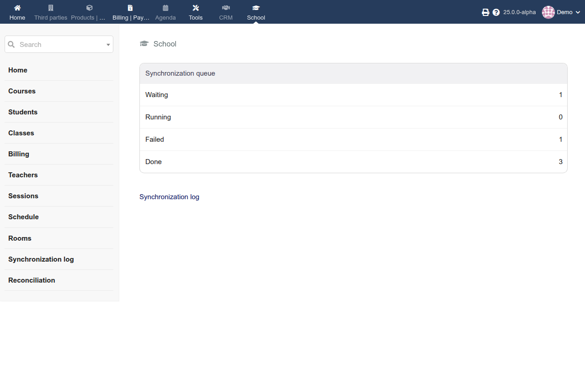

*The School home page: connection state and the synchronization queue.*

## Courses

**School > Courses** lists the Chamilo courses that Dolibarr knows: reference, label, language, Chamilo id, date of the last synchronization. The reference opens the service product.

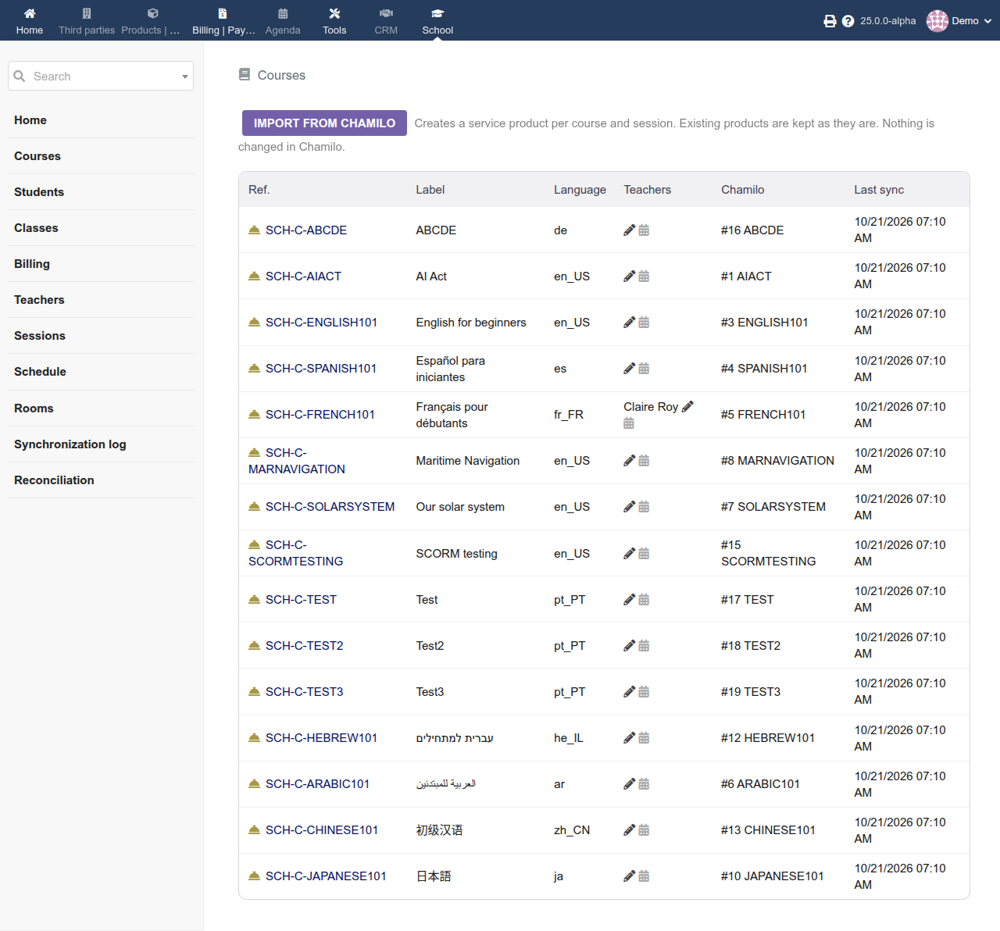

*The Courses page, with Import from Chamilo, the teachers pencil and the schedule icon.*

| Option | In Dolibarr | In Chamilo |
|---|---|---|
| **Import from Chamilo** (needs *sync*) | Creates one service product per course and per session of Chamilo that Dolibarr does not know yet: **not for sale**, **price 0**. Run it again later: it adds what is new and refreshes the language and the dates, and never overwrites a label, price or sale status you set. | Nothing is changed. |
| Pencil in the **Teachers** column (needs *teacher*) | Opens the choice of the teachers of the course (see Teachers). | |
| Calendar icon | Opens the course's schedule (see Schedule). | |

After importing, set the price of the courses you sell and mark them for sale, from the product card, as for any product.

## Sessions

**School > Sessions** lists the sessions: display dates, access dates, number of courses, Chamilo id and synchronization state.

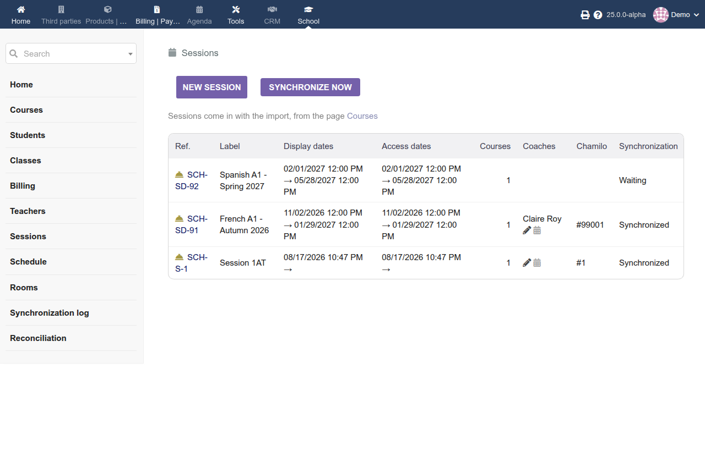

*The Sessions page: state of each session, New session and Synchronize now.*

| State | Meaning |
|---|---|
| Waiting | Created in Dolibarr, not sent to Chamilo yet |
| Synchronized | Chamilo has it |
| Error | Chamilo refused it. Point at the word *Error* to read why. |

| Option | In Dolibarr | In Chamilo |
|---|---|---|
| **New session** (needs *write*) | Opens the form below. | |
| **Synchronize now** (needs *sync*) | Sends everything that waits, and reads back attendance. | The waiting changes are applied. |
| Pencil in the **Coaches** column (needs *teacher*) | Choose, for each course of the session, who coaches it (see Teachers). Shown when the session is in Chamilo and has courses. | |
| Calendar icon | Opens the session's schedule. | |

### Creating a session

On **New session**, fill in:

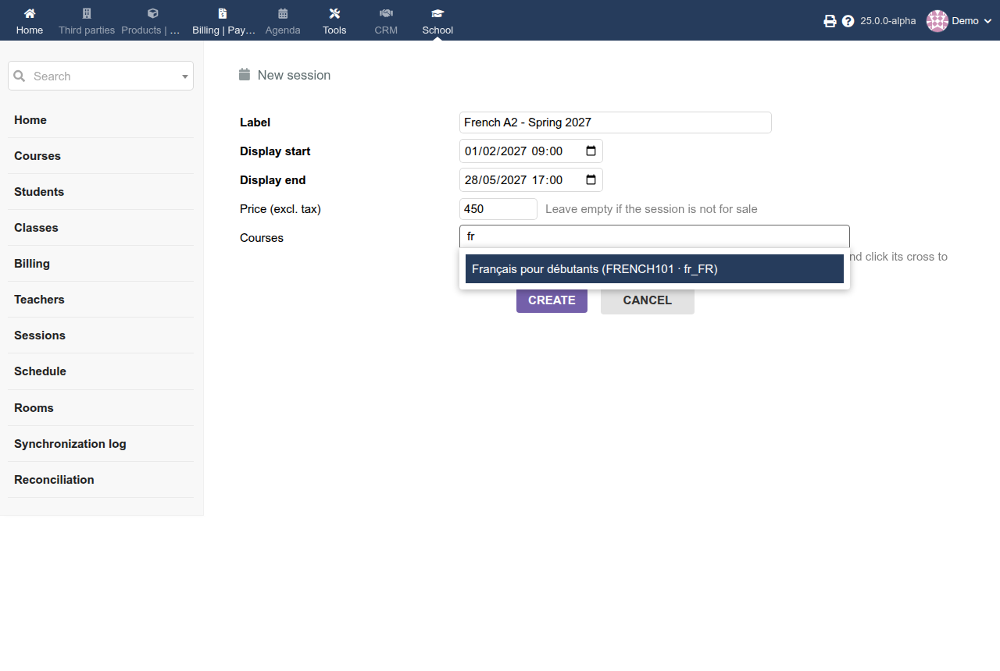

*The new session form. Typing in the Courses box filters the list on the title or the code of the course.*

| Field | In Dolibarr | In Chamilo |
|---|---|---|
| **Label** (required) | The label of the service product (reference `SCH-SD-<n>`) | The title of the session |
| **Display start**, **Display end** (required, end not before start) | Dates of the session | The display dates, and also the access dates of the session |
| **Price (excl. tax)** | The price of the product; empty or 0 means not for sale. It is what invoices use. | Written on the session as `price`, only when above zero (the Chamilo storefront reads it) |
| **Courses** | The courses the session contains. A **searchable list**: type part of the title or of the code to filter it (it stays usable with hundreds of courses), click a course to add it, click its cross to remove it. Only courses that came from Chamilo are offered: import first if the list is empty. | The courses are linked to the session |

The session exists in Dolibarr at once, and reaches Chamilo at the next synchronization. Students are not enrolled by this step.

## Teachers

**School > Teachers** lists your employees (Dolibarr users flagged as employees). A teacher is an employee who also has a Chamilo account.

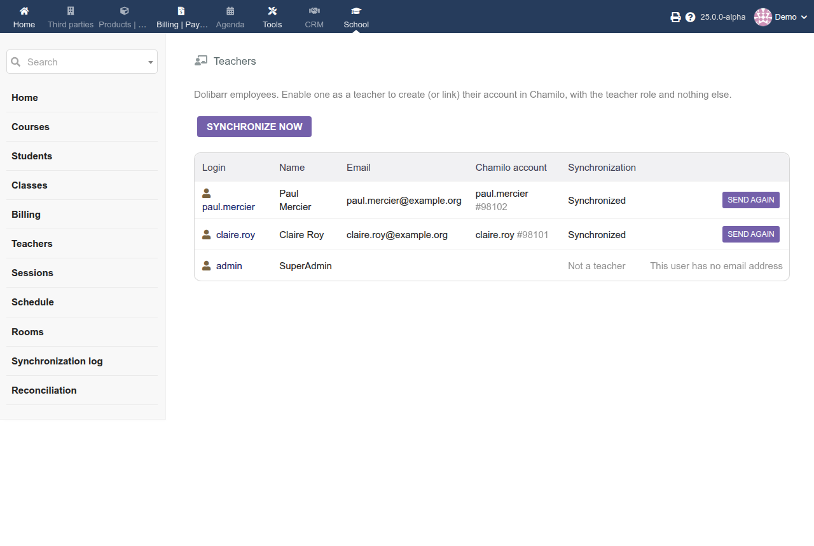

*The Teachers page: employees, their Chamilo account and Enable on Chamilo.*

| Option | In Dolibarr | In Chamilo |
|---|---|---|
| **Enable on Chamilo** (needs *teacher*; the employee needs an email) | The employee becomes a teacher. | An account is created with the **teacher role and nothing else**; Chamilo emails them a link to choose a password. The username is the Dolibarr login, or with a number (`jdoe.2`) if taken. If an account with the same email exists, it is **linked as it is**, and a warning icon shows when it is not a teacher. |
| **Send again** | Queues an update of the account. | The name, email, phone and active state of the account follow the Dolibarr user. |
| **Synchronize now** (needs *sync*) | | |

Afterwards the account follows the Dolibarr user by itself: changing the name, email or phone, or disabling the user, is sent to Chamilo. A teacher account that was deleted in Chamilo is not recreated by itself.

### Choosing the teachers of a course

On **Courses**, the pencil in *Teachers*: tick the teachers and **Save**. They become the teachers of the course in Chamilo (unticking removes them from it). Needs the *teacher* right.

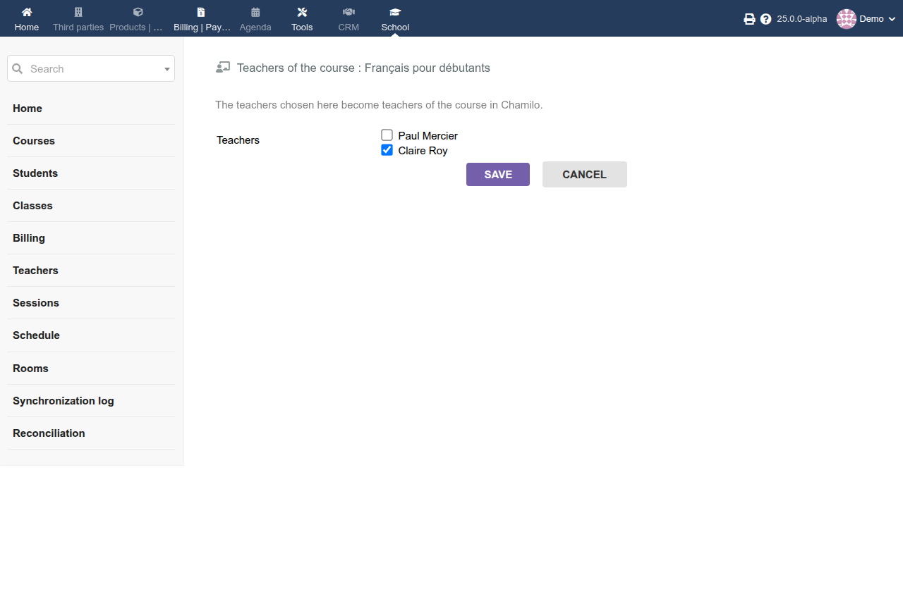

*Choosing the teachers of a course.*

### Choosing the coaches of a session

On **Sessions**, the pencil in *Coaches*: for each course of the session, tick who coaches it in this session, and **Save**. In Chamilo they become the coaches of that course in that session. The teachers also appear on the agenda events of the dates of that course (see Schedule).

## Students

**School > Students** lists the students (a **Search** box filters by name or reference; **Synchronize now** needs *sync*). A student is not a third party: the **parents** are your customers, and a student is linked to them.

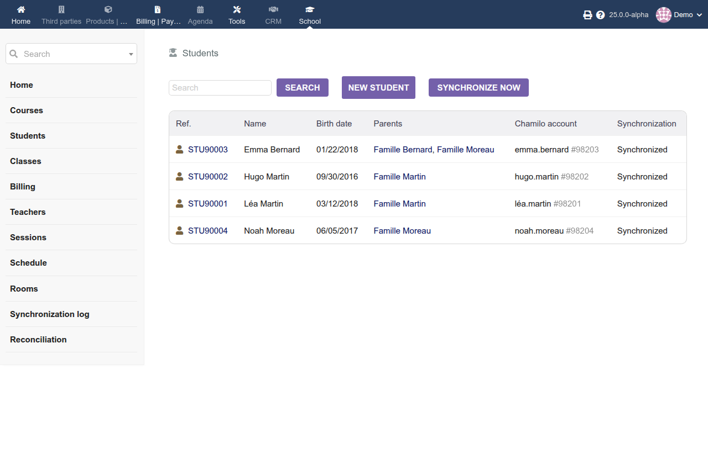

*The Students page, with its search box.*

### Creating a student

**New student** (needs *write*):

| Field | In Dolibarr | In Chamilo |
|---|---|---|
| First name, last name (required) | The student (reference `STU…`) | The account's name; the username is built from it (`elodie.francois`, a number if taken) |
| Birth date | Kept | Not sent |
| Email (optional) | Kept | The account's email. Without one, Chamilo gets the address of the first parent that has one, with the username after a plus sign (`parent+elodie.francois@example.org`), so that the parent receives the message to choose the password. If no parent has an address either, the administrator's placeholder domain is used; without it the student shows an error that says how to fix it. |

The account is created at the next synchronization, with the **student role**; Chamilo's new-account message is sent unless your administrator turned it off.

### The student's card

| Option | In Dolibarr | In Chamilo |
|---|---|---|
| Change name, birth date, email, **Save** | Updates the student | The name and email of the account are updated |
| **Active** (untick to deactivate) | Marks the student inactive. A student cannot be deleted: deactivate instead. | The account is deactivated; ticking again reactivates it |
| **Send again** | Queues an update of the account | The account is brought up to date |
| **Parents** | See below | |
| **Enrolments** | See below | |
| **Attendance** | Totals and latest dates read back from Chamilo | |

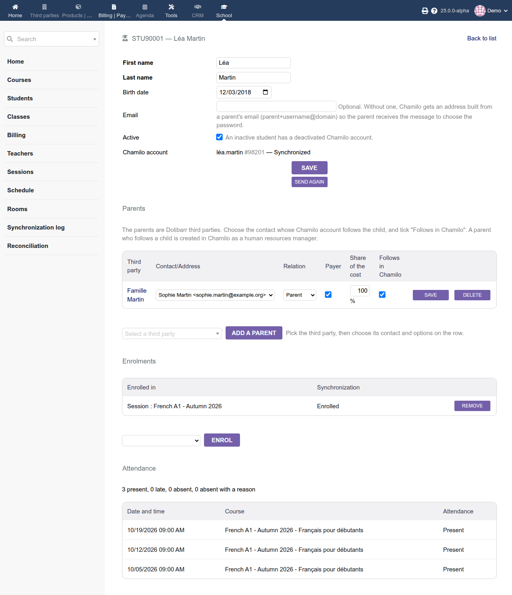

*A student's card: details, parents, enrolments and attendance.*

## Parents

On the student's card, under **Parents**: pick a third party, **Add a parent**, then complete its row and **Save**. A parent may be linked to several children and a child to several parents. A third party's card has a **Children** tab listing its children.

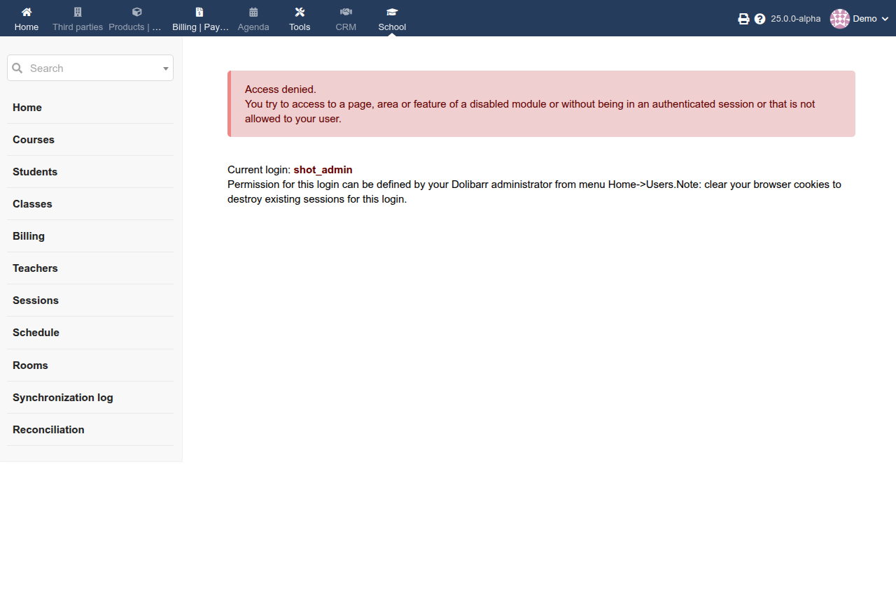

*The Children tab on the card of a third party lists the children that parent is linked to.*

| Option | In Dolibarr | In Chamilo |
|---|---|---|
| **Contact** | The person at that third party. Used for announcements and for the Chamilo account of a parent who follows. | |
| **Relation** (parent, guardian, other) | Kept for information | Not sent |
| **Payer** | The parent is invoiced for this child (see Billing). A child with no payer cannot be invoiced. | Not sent |
| **Share of the cost** (0-100) | The part of the cost this parent pays. With two payers it is asked again when invoicing, must add up to 100, and is kept for next time. | Not sent |
| **Follows in Chamilo** (needs a contact with an email) | Marks that the parent follows the child | A **parent account** is created from the contact, with the human resources manager role (the role that follows other users; in Chamilo it can be renamed "parent"), and it is linked to the child as a follower. One account per contact, shared by all their children. An existing account with the same email is linked, never changed. |
| Untick **Follows**, or **Delete** the row | Stops following / removes the link | The following relation is removed; the parent account is kept |

## Enrolments

On the student's card, under **Enrolments**:

| Option | In Dolibarr | In Chamilo |
|---|---|---|
| **Enrol** in a session or a course (only items that are in Chamilo are offered) | An enrolment is recorded (*Waiting*, then *Enrolled*) | In a session: the student is subscribed to the session and so to **all its courses**. In a course: subscribed to that course as a student. |
| **Remove** | The enrolment is marked *Removal waiting*, then deleted | The student is taken out of that session or course |

A student is also enrolled in the sessions that their **class** follows (see Classes): that is done by Chamilo and does not appear as an enrolment here. Enrolments are what Billing invoices.

## Classes

A **class** is the students who follow the same sessions for a teaching cycle (which need not be a school year). **School > Classes** lists them (**Show archived classes** adds the archived ones; **Synchronize now** needs *sync*). Classes need the *class* right.

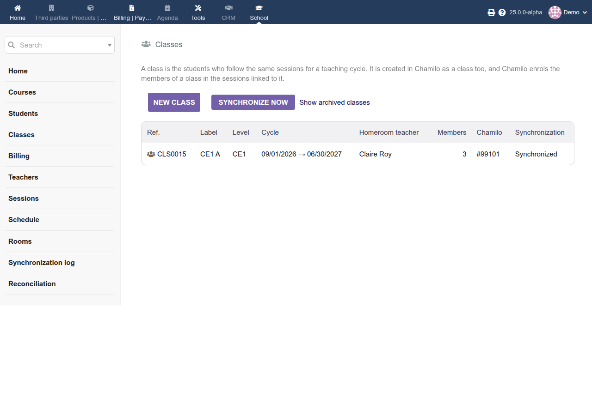

*The Classes page.*

### Creating and editing a class

**New class**, then the card:

| Field | In Dolibarr | In Chamilo |
|---|---|---|
| **Name** (required) | The class | The title of the class (a Chamilo class, "normal class" type) |
| **Level** | Kept | The description of the class |
| **Start / end of the cycle** (optional, YYYY-MM-DD, end not before start) | Kept | Not sent |
| **Homeroom teacher** | Kept | Not sent |
| **Active** (untick to archive) | An archived class is hidden from the lists and from announcements | Not changed |
| **Send again** | Queues an update | The class, its members and its sessions are brought up to date |

### Members and sessions

| Option | In Dolibarr | In Chamilo |
|---|---|---|
| **Add** a student, with a **From** date | The student joins the class from that day (today by default) | The student is added to the Chamilo class, and Chamilo **enrols them in every session the class follows** |
| **Remove** | The membership ends the day before; the row stays so past announcements and invoices stay traceable. The student can join again later. | The student leaves the Chamilo class and is taken out of the class's sessions |
| **Sessions of the class**: add / remove a session | The class follows (or stops following) the session | Chamilo links the session to the class, and enrols (or unenrols) all the members |

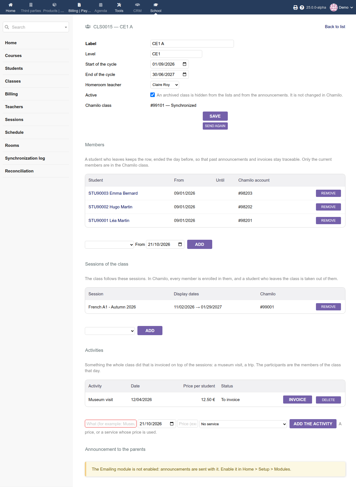

*A class card: details, members, sessions of the class, activities and the announcement form.*

Only the **current** members are in the Chamilo class. A student without a Chamilo account yet is left out and flagged "no account yet"; they join by themselves once the account exists. Adding a student to a class that does not exist, or a session twice, is refused.

### Announcing something to all the parents

At the bottom of the card, write a **Subject** and a **Message** and press **Prepare the announcement**. This is Dolibarr only (nothing goes to Chamilo): the parents of the current members are the recipients, one message per address even with several children in the class, to the contact chosen on the student's card or else to the third party. You land on a **draft campaign** in the **Emailing** module: check the recipients and the text, then validate and send it there. Nothing is sent before. It needs the Emailing module enabled and the right to create emailings.

### Activities of the class

Under **Activities**: something the whole class did, invoiced on top of the sessions (a museum visit, a trip). Dolibarr only.

| Option | What it does |
|---|---|
| **What**, **day**, **price per student** or **a service** (whose price is used), **Add the activity** | Records the activity. Give a price or a service. |
| **Invoice** (needs *invoice*) | Opens Billing for this activity: the participants are the members of the class that day. |
| **Delete** | Deletes an activity that was not invoiced (delete its draft invoices first otherwise) |

## Billing

**School > Billing** invoices what parents owe (needs the *invoice* right, the right to create invoices, and the Invoices module). Everything it creates is a **draft invoice**: you check it and validate it in Dolibarr. Nothing goes to Chamilo.

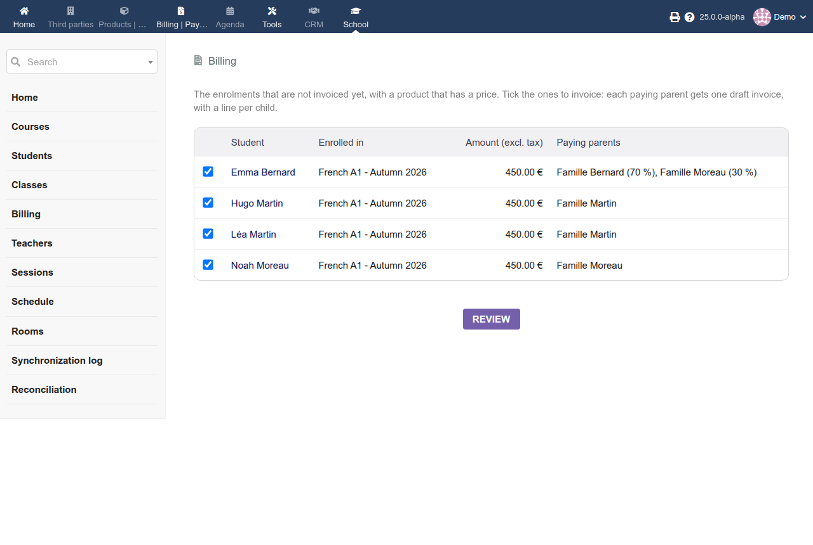

*Billing: the enrolments not invoiced yet, with the paying parents and their shares.*

**Who pays**: tick **Payer** for the parents who pay on the student's card; with two payers you give each one's **share** (for example 70 % and 30 %) when invoicing, and it is remembered for that child.

| Step / option | What it does |
|---|---|
| The list | The enrolments that are not invoiced yet and whose session or course has a price (or, from an activity, the participants not invoiced yet). A child with no payer is flagged. |
| Tick, then **Review** | Shows what each parent will be invoiced: **one invoice per paying parent**, with a line per child, so a family with two children gets a single invoice. |
| **Recalculate** | After you change the shares, shows the new amounts. The shares of a child must add up to 100. |
| **Create N draft invoices** | Creates the drafts and keeps the shares for next time; the result links each draft. VAT and payment terms come from Dolibarr's usual defaults (the seller company, the product, the third party). |

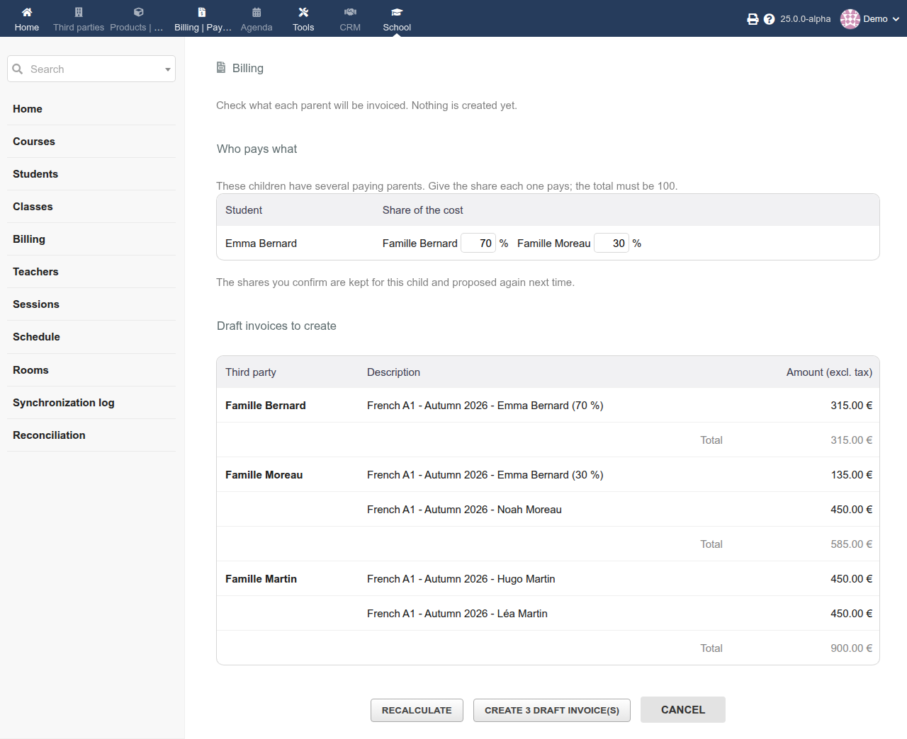

*The review step: one draft invoice per paying parent, with a line per child.*

If a draft is wrong, **delete** it: what it covered is offered again. If only one of two payers' drafts is deleted, only that part is offered again. An item is never invoiced twice.

## Rooms

**School > Rooms** lists the rooms. A room is a resource of Dolibarr's **Resources** module that the school uses for lessons. Needs the Resources module.

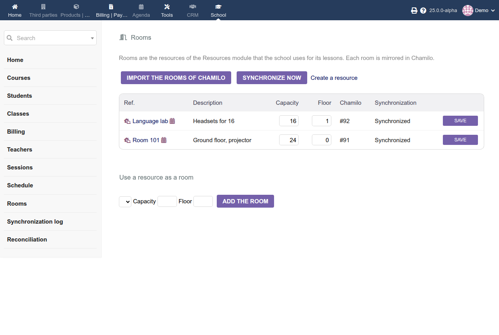

*The Rooms page: capacity and floor are edited on the row.*

| Option | In Dolibarr | In Chamilo |
|---|---|---|
| **Create a resource** | Opens the Resources module to create a resource, which you then use as a room | |
| **Use a resource as a room** (a resource, optional **capacity** and **floor**, **Add the room**; needs *write*) | The resource becomes a room | A room is created in Chamilo (in the branch chosen by the administrator) with the resource's name, the capacity and the floor |
| **Capacity**, **Floor**, **Save** on a row | The capacity is the resource's own "max users" (so it also shows in the Resources module); the floor is kept by the module | Updated on the Chamilo room |
| Calendar icon | Opens the room's planning in the Resources module | |
| **Import the rooms of Chamilo** (needs *sync*) | Creates the resources, and the rooms, for the rooms Chamilo already has (matched by name) | Nothing is changed |
| **Synchronize now** | | Sends the waiting changes |

## Schedule

The dates on which a course meets. Open them from the calendar icon of a session or a course; **School > Schedule** shows the dates to come for everything, and can be limited to **one room**.

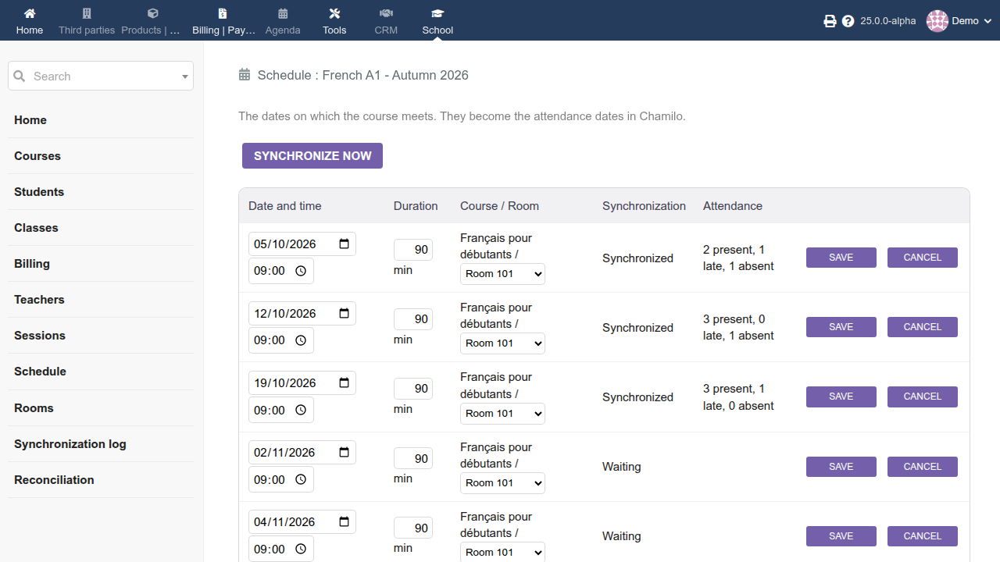

*The schedule of a session: the dates with their rooms and synchronization state, and the attendance read back from Chamilo for the dates that took place (here three past dates, then dates that wait to be sent).*

### Adding dates

Under **Add dates** (needs *write*):

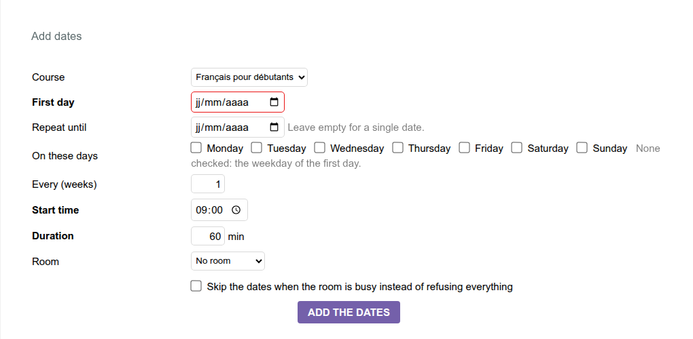

*The Add dates form, below the dates of a session.*

| Field | Meaning |
|---|---|
| **Course** (for a session) | The course of the session the dates are for |
| **First day**, **Repeat until** | One date, or a series up to a last day |
| **On these days** | The weekdays of the series (none ticked: the weekday of the first day) |
| **Every (weeks)** | 1 = every week, 2 = every other week... |
| **Start time**, **Duration** (5 minutes to 12 hours) | When, and how long |
| **Room** | Optional |
| **Skip the dates when the room is busy** | Without it, one busy date refuses the whole series; with it, busy dates are skipped and listed |

**In Dolibarr**, each date is an event of the agenda, with the room booked and the **teachers** of the course (or the coaches of the session) assigned, so the room's planning and the teachers' agenda stay right. A room cannot be booked twice at the same time (a lesson may start when the previous one ends), nor over its capacity; a teacher who already has a lesson then is only warned. **In Chamilo**, each date becomes a date of the attendance of the course (or of the course in the session), with its room; the attendance is created the first time.

### Changing and cancelling

| Option | In Dolibarr | In Chamilo |
|---|---|---|
| Change the day, time, duration or room, then **Save** | The event and the room booking move | The date is moved |
| **Cancel** | The date is cancelled and frees the room (shown *Cancelled, to be removed in Chamilo* until Chamilo has removed it) | The date is removed from the attendance |

**A date whose attendance was already taken in Chamilo is protected**: it is neither moved nor removed there (only its room can change), and the date stays marked as waiting with the reason.

## Attendance

Teachers record who was present **in Chamilo**. Dolibarr reads it back about every half hour once a date has taken place, until Chamilo says the attendance was taken:

- the **Schedule** shows, for each date, how many were present, late and absent, marked *(not final)* until the attendance is taken;
- the card of a student has an **Attendance** section: totals (present, late, absent, absent with a reason) and the latest dates.

Nothing is recorded in Dolibarr and nothing is sent back to Chamilo.

## Synchronization log

**School > Synchronization log** lists everything the module sends to Chamilo, newest first: what (student, class, session, date...) with a link to it, its state, the number of attempts, the next try and the message.

*The synchronization log: a failed job with Try again and Forget, and a job waiting for its next try.*

| Option | What it does |
|---|---|
| Click a state (*Waiting*, *Running*, *Failed*, *Done*), or the **status** and **type** filters, then **Search** | Filters the list |
| **Try again** (needs *sync*) | Puts a failed job (or a waiting one that already failed once) back in line at once |
| **Try the N failed again** | Puts every failed job back in line |
| **Forget** | Removes a failed job. The object keeps its error, and is sent again when it changes. |
| **Synchronize now** | Runs the queue now |

A *Waiting* job with "next try" in the future is waiting for the pause between retries (1 minute, then longer, up to an hour). A running or done job cannot be retried. Done jobs are cleaned up after 30 days (the administrator can change this).

## Reconciliation

**School > Reconciliation** (needs *sync*) answers "does Chamilo still say what Dolibarr says?". Tick the **areas** (courses, sessions, students, teachers, enrolments, classes, rooms, dates to come) and press **Run the check**. It changes nothing.

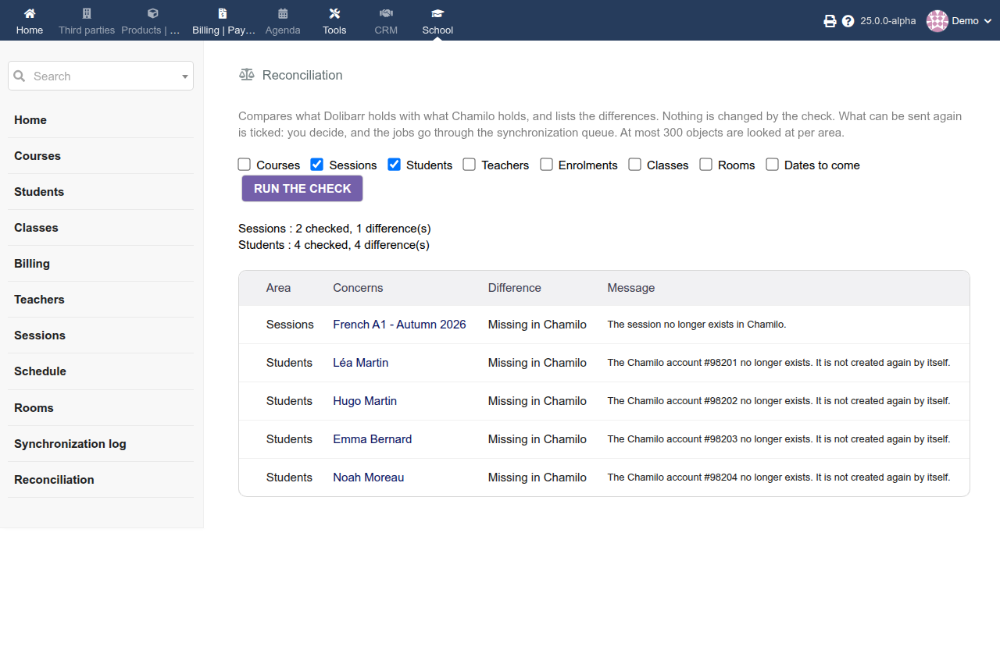

*A reconciliation report for two areas. Here the demo accounts and session do not exist in Chamilo, so each is reported as missing; a real difference that sending again can fix comes with a ticked box and the button Send the ticked ones again.*

Each difference is *Missing in Chamilo* (an account, session, class, room or date that is gone, or not there yet), *Different* (a name, an active state, a member, a date that moved), *Only in Chamilo* (something Chamilo has that Dolibarr does not expect, such as a course not imported yet) or *Could not be checked*. Differences that sending again would fix are **ticked**: press **Send the ticked ones again** to queue them (you land on the synchronization log). What was **deleted in Chamilo** is only reported: the module never recreates it by itself, so you decide. A big school is checked area by area (at most 300 objects per area).

## Using an assistant (MCP)

If your administrator has set up Dolibarr's AI assistant or MCP server for you (see [ADMIN_GUIDE.md](ADMIN_GUIDE.md), "MCP tools"), you can ask an AI assistant to do most of what this guide describes, in your own words. The assistant works through the same rules as the screens and only with the rights of the Dolibarr user it acts as.

### How it works

1. You ask, for example "Enrol Ana Martin in the autumn French session".
2. The assistant looks things up (students, sessions...) and says what it will do.
3. **Before it changes anything, it asks you to confirm**, with a sentence such as "Create the student Ana Martin." (Dolibarr 25; on 24.0 your administrator may have no confirmation step, so be precise).
4. A change that concerns Chamilo is **queued** like a change made on a screen: ask the assistant to run the synchronization, or look in the synchronization log.
5. What it prepares is a **draft**: an invoice is never validated, and an announcement is never sent. You review both in Dolibarr as usual.

### What you can ask

| You want to... | You can say... | What happens | Right needed |
|---|---|---|---|
| See courses, sessions, students, classes, teachers, rooms, dates | "List the sessions", "Show the class CE1 with its members" | Read only | read |
| Create a session | "Create a session Spring 2027 from 1 March to 30 June at 120 with the courses French and Maths" | Session product and Chamilo session | write |
| Import from Chamilo | "Import the courses and sessions of Chamilo" | Products for what is new | sync |
| Create a student, change one, deactivate one | "Create a student Ana Martin born 2 April 2015", "Deactivate Ana" | Student; account created or updated in Chamilo | write |
| Link a parent | "Make Dupont SARL a paying parent of Ana, 100 %", "make the second parent pay 30 %" | Parent link, payer, share, following | write |
| Enrol or unenrol | "Enrol Ana in the Spring session", "Remove her enrolment" | Enrolment queued for Chamilo | write |
| Make a teacher, choose teachers | "Make Claire Roy a teacher", "Claire teaches French in the Spring session" | Chamilo account; teachers and coaches | teacher |
| Manage a class | "Create the class CE1, add Ana from 1 September, make it follow the Spring session", "End Ana's membership" | Class, members and sessions, mirrored in Chamilo | class |
| Announce to parents | "Prepare an announcement to the parents of CE1: trip on Friday" | A **draft** campaign in Emailing (not sent) | class + Emailing create |
| Record an activity | "Record a museum visit of CE1 on 5 December at 12.50 per student" | Activity of the class | class |
| Invoice | "What can be invoiced?", "Create draft invoices for these items" | **Draft** invoices, one per paying parent | invoice + Invoices create |
| Manage rooms and dates | "Use the resource Room 3 as a room, capacity 20", "Every Monday at 9:00 from 1 February to 29 March, 90 minutes, Room 3, for French in the Spring session", "Move that date to Tuesday 14:00", "Cancel it" | Rooms, agenda events, bookings, Chamilo attendance dates | write |
| See attendance | "How was Ana's attendance?" | Totals and dates read back from Chamilo | read |
| Look after synchronization | "How many jobs failed?", "Why did Ana's account fail?", "Try the failed ones again", "Run the synchronization", "Compare Dolibarr and Chamilo for the classes" | Log, retry, reconciliation (the fixes it proposes are queued only when you ask) | read / sync |

### Good habits

- **Name things precisely** (the full name of a session, a date as 2027-02-01): the assistant asks when something is ambiguous, but it works best with clear requests.
- **Check what it proposes**, above all for invoices and for series of dates: it shows the amounts, the shares, and the dates that were skipped because a room was busy.
- **Read its answers about Chamilo as "queued"**: a change is not in Chamilo until the synchronization has run.
- **It cannot do what you cannot do.** "Permission denied: the right school/... is required" means your user lacks that right: ask your administrator. A tool that is not available at all has not been allowed for the assistant.
- **Personal data.** To answer, the assistant reads the data of students and parents. It goes to the AI service your assistant uses: ask your administrator which one, and about Dolibarr's privacy option for AI prompts.
- It never deletes anything in Chamilo, never sends an e-mail, never validates an invoice and never changes a Chamilo role.

## When something is not synchronized

- A change that waits is normal for a few minutes. Press **Synchronize now** to send it at once.
- If Chamilo is unreachable, the module tries again by itself, with longer and longer pauses, for several hours.
- A session in state *Error* was refused by Chamilo: read the message (point at *Error*), correct the data, and use **Try again** in the synchronization log.
- A number under *Failed* on the home page means the same thing for any other change: the **Synchronization log** shows what and why.
- To find out whether something is really in Chamilo, run the **Reconciliation**.

## What is coming

These are planned and are not available yet:

- creating and editing courses from Dolibarr, and changing a session you created;
- reading other things back from Chamilo (changes made there to courses or sessions);
- orders in addition to invoices.
